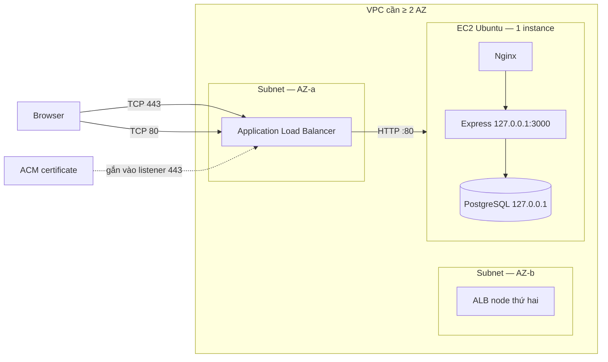

# Issue #34 — Thiết kế tích hợp Application Load Balancer

**Trạng thái: PROPOSED — thiết kế trên giấy, chưa tạo resource nào trên AWS.**

Tài liệu này trả lời câu hỏi "nếu đưa ALB vào kiến trúc PBL4-517 thì phải làm gì, theo thứ
tự nào, và chỗ nào dễ làm hỏng hệ thống đang chạy". Mọi dòng trong đây là **đề xuất**;
chưa có ALB, Target Group, listener hay Security Group mới nào được tạo.

- Issue: [#34 — AWS-05](https://github.com/LVTIT/PBL4-517/issues/34)
- Kiến trúc canonical: [wiki/ARCHITECTURE.md](../../wiki/ARCHITECTURE.md)
- Hạ tầng đang chạy: [docs/aws/ec2-deployment-review.md](ec2-deployment-review.md),
  [docs/aws/linux-service-review.md](linux-service-review.md)
- Bối cảnh bảo mật: [wiki/SECURITY_PLAN.md](../../wiki/SECURITY_PLAN.md)

---

## 1. Kiến trúc hiện tại (đã triển khai, không phải đề xuất)

```
Internet
   │  TCP 80/443
   ▼
Security Group "launch-wizard-1"
   │   22/TCP  ← IP quản trị /32
   │   80/TCP  ← 0.0.0.0/0
   │   443/TCP ← 0.0.0.0/0
   ▼
EC2 Ubuntu 24.04
   └── Nginx 1.24.0
         ├── listen 80   → 308 redirect sang https
         ├── listen 443  → Let's Encrypt cert cho địa chỉ IP
         ├── /           → frontend/dist (React SPA)
         └── /api/       → proxy_pass http://127.0.0.1:3000
                                │
                                ▼
                           Express (systemd: pbl4-backend.service)
                                │
                                ▼
                           PostgreSQL 16 @ 127.0.0.1:5432
```

Sự thật kỹ thuật quan trọng, dùng xuyên suốt tài liệu:

| Thuộc tính | Giá trị hiện tại | Nguồn |
| --- | --- | --- |
| Backend bind | `127.0.0.1:3000` (chỉ loopback) | `docs/aws/linux-service-review.md` |
| PostgreSQL bind | `127.0.0.1:5432` | như trên |
| TLS | Let's Encrypt, cấp cho **địa chỉ IP** | `docs/aws/ec2-deployment-review.md` |
| `TRUST_PROXY` | chỉ nhận `'0'` hoặc `'loopback'` | `website/backend/src/lib/config.ts` |
| Cookie `Secure` | bật khi `NODE_ENV=production` | `website/backend/src/middleware/session.ts` |
| Nginx set `X-Forwarded-Proto` | `$scheme` | `docs/aws/ec2-deployment-review.md` |
| Nginx set `X-Forwarded-For` | `$remote_addr` | như trên |
| Health endpoint | `GET /api/health`, phụ thuộc database | `website/backend/src/routes/api-routes.ts` |

---

## 2. Kiến trúc đề xuất



Luồng request:

1. Browser → ALB:443 (TLS kết thúc tại ALB).
2. ALB → Target Group → EC2:80 (HTTP nội bộ VPC, chỉ ALB Security Group được gọi).
3. Nginx phục vụ frontend tĩnh và proxy `/api/` về `127.0.0.1:3000`.
4. Express đọc session từ PostgreSQL như hiện tại.

**Nguyên tắc bất biến:** ALB **không** được trỏ trực tiếp vào cổng 3000. Backend đang bind
loopback; mở nó ra VPC là hạ mức bảo mật hiện có. Nginx phải tiếp tục là biên giới.

---

## 3. Sáu ràng buộc phải xử lý trước khi tạo ALB

Đây là phần quyết định thành bại của issue. Bỏ qua bất kỳ mục nào cũng sẽ hỏng hệ thống
đang chạy.

### R1 — ALB bắt buộc ít nhất 2 subnet ở 2 Availability Zone khác nhau

Theo [tài liệu AWS](https://docs.aws.amazon.com/elasticloadbalancing/latest/application/application-load-balancers.html),
ALB yêu cầu chọn **tối thiểu hai subnet thuộc hai AZ khác nhau**, mỗi subnet có CIDR tối
thiểu `/27` và còn ít nhất 8 IP trống.

Hệ quả cho dự án: hiện chỉ có một EC2, nhưng vẫn **phải có subnet thứ hai**. Subnet thứ hai
không cần target; ALB vẫn tạo node ở đó. Việc này kéo theo:

- phải biết VPC hiện tại đã có subnet ở AZ thứ hai chưa;
- nếu chưa, phải tạo subnet + route table (không tốn phí bản thân subnet);
- nếu dùng cross-zone, traffic giữa hai AZ có thể phát sinh phí data transfer.

**Việc cần làm ở P0:** chụp lại VPC ID, danh sách subnet, AZ và CIDR từ console. Không
đoán.

### R2 — Target phải là `EC2:80` (Nginx), không phải `EC2:3000`

Backend bind `127.0.0.1:3000`. Một ALB nằm ngoài instance **không thể** kết nối tới địa chỉ
loopback. Vì vậy Target Group đăng ký theo **instance ID** với cổng `80`, giao thức `HTTP`.

Nếu sau này muốn ALB nói chuyện trực tiếp với Node, phải đổi bind sang private IP và thêm
một lớp kiểm soát khác — nằm ngoài phạm vi issue này và không được khuyến nghị.

### R3 — Chứng chỉ: ACM không cấp cho địa chỉ IP

[ACM public certificate](https://docs.aws.amazon.com/acm/latest/userguide/gs-acm-request-public.html)
yêu cầu *"DNS-compliant subject names"*, tức phải là tên miền. Chứng chỉ hiện tại trên EC2
đã được kiểm tra ngày 2026-11-01 bằng TLS handshake thật:

```text
subject        : (rỗng)
issuer         : Let's Encrypt, CN=YE2
subjectAltName : IP Address = 13.251.128.130
notAfter       : Nov 5 11:42:53 2026 GMT
TLS            : TLSv1.3
```

Chứng chỉ cấp cho **IP**, không có `DNSName` nào. Vì vậy nó **không dùng lại được** cho
listener 443 của ALB, và cũng không thể import sang ACM để dùng đúng cách.

Vòng đời quan sát được: `notBefore = Oct 29 19:42:54 2026`, `notAfter = Nov 5 11:42:53 2026`
— chênh lệch khoảng 6,7 ngày, đúng profile `shortlived` mà
[docs/aws/ec2-deployment-review.md](ec2-deployment-review.md) đã ghi. Điều này cho thấy
Certbot đã tự gia hạn thành công ít nhất một lần sau khi triển khai, không phải chứng chỉ
sắp hết hạn do bị bỏ quên. Tuy vậy, vì chứng chỉ chỉ sống ~6 ngày, mọi khoảng gián đoạn của
timer trong tương lai sẽ làm site lỗi rất nhanh — đây là lý do kỹ thuật để chuyển TLS sang
ALB/ACM nếu có tên miền, chứ không chỉ là chuyện thẩm mỹ.

Ba đường đi, phải chọn một trước khi triển khai:

| Phương án | Điều kiện | Đánh giá |
| --- | --- | --- |
| **A. Dùng tên miền + ACM** | Có tên miền trỏ về ALB (Route 53 hoặc DNS ngoài) | Đề xuất. Đúng mô hình ALB, cert tự renew, không cần cert trên EC2 |
| **B. Giữ Nginx TLS, dùng NLB** | Không cần tên miền, NLB passthrough TCP 443 | ALB **không** làm được TCP passthrough. NLB mất khả năng định tuyến L7. Ngoài phạm vi #34 nhưng là phương án trung thực nếu không có domain |
| **C. ALB + cert tự ký import** | Import cert vào ACM/IAM | Không đề xuất: trình duyệt cảnh báo, không chứng minh được gì khi demo |

**Chưa có tên miền trong dự án.** Đây là câu hỏi phải chốt với Team Leader trước khi làm
bất cứ bước nào, vì nó quyết định toàn bộ phần còn lại.

### R4 — `X-Forwarded-Proto` sẽ làm hỏng đăng nhập nếu giữ nguyên cấu hình Nginx

Đây là lỗi tinh vi nhất và gần như chắc chắn xảy ra.

Chuỗi hiện tại khi có ALB:

```
Browser --HTTPS--> ALB --HTTP :80--> Nginx --HTTP--> Express
```

Nginx đang đặt `proxy_set_header X-Forwarded-Proto $scheme;`. Sau ALB, `$scheme` tại Nginx
là `http`, nên Express nhận `X-Forwarded-Proto: http` → `req.secure === false`.

Trong khi đó `cookieOptions.secure = config.NODE_ENV === 'production'`
(`website/backend/src/middleware/session.ts`). Với `secure: true`, express-session **không
gửi cookie** khi request không được coi là HTTPS. Kết quả: đăng nhập trả 200 nhưng trình
duyệt không nhận được `pbl517.sid`, mọi request sau đó thành 401 — và rất khó đoán nguyên nhân.

Cách sửa (chọn một, ghi rõ trong cấu hình Nginx):

```nginx
# ALB đã set header này; Nginx chuyển tiếp thay vì ghi đè
proxy_set_header X-Forwarded-Proto $http_x_forwarded_proto;
```

hoặc, nếu chắc chắn mọi request vào Nginx đều đến từ ALB qua HTTPS:

```nginx
proxy_set_header X-Forwarded-Proto https;
```

Sau khi sửa **phải kiểm thử đăng nhập thật**, không chỉ kiểm tra header bằng curl.

### R5 — Mất IP thật của client

Nginx đang đặt `X-Forwarded-For $remote_addr`. Sau ALB, `$remote_addr` là **IP node của ALB**,
nên log, rate-limit và audit đều ghi sai người gửi. Rate limit đăng nhập hiện đếm theo IP
(`express-rate-limit`) — nếu mọi request cùng một IP ALB thì giới hạn sẽ áp dụng sai.

Cách sửa: bật `ngx_http_realip_module` với dải IP của ALB:

```nginx
set_real_ip_from <ALB subnet CIDR 1>;
set_real_ip_from <ALB subnet CIDR 2>;
real_ip_header X-Forwarded-For;
real_ip_recursive on;
```

Điều kiện an toàn: ALB phải giữ chế độ mặc định `routing.http.xff_header_processing.mode =
append` (ALB nối thêm IP client). Nếu đổi sang `preserve`, client có thể tự gửi
`X-Forwarded-For` giả và đánh lừa `real_ip`.

### R6 — Redirect 80 → 443 sẽ tạo vòng lặp hoặc đi thẳng vào EC2

Cấu hình hiện tại trên EC2:

```nginx
location / { return 308 https://47.129.214.70$request_uri; }
```

Khi ALB nói chuyện với Nginx qua cổng 80, Nginx sẽ trả 308 về `https://<IP>` — tức là
**bỏ qua ALB** và quay lại đúng con EC2. Hệ quả: phần TLS/lợi ích của ALB không được dùng,
và nếu Security Group EC2 đã đóng 443 công khai thì người dùng nhận lỗi kết nối.

Cách sửa: chuyển redirect lên **listener 80 của ALB** (ALB tự trả 301/302 sang 443), và
trong server block phía sau ALB thì **bỏ** dòng `return 308`, đổi `server_name` sang tên miền
mới.

### R7 — Health check phải phản ánh đúng sức khoẻ

Đề xuất Target Group health check:

| Tham số | Giá trị đề xuất | Lý do |
| --- | --- | --- |
| Path | `/api/health` | Có kiểm tra `SELECT 1` xuống PostgreSQL |
| Protocol / Port | HTTP / 80 (traffic port) | Đi qua Nginx như người dùng thật |
| Interval | 15 s | Cân bằng giữa phát hiện nhanh và tải |
| Timeout | 5 s | Nhỏ hơn interval |
| Healthy threshold | 2 | 30 s để nhận target |
| Unhealthy threshold | 3 | 45 s để loại target |
| Success codes | `200` | Chỉ 200 mới là khoẻ |

Đánh đổi cần biết: `/api/health` phụ thuộc database. Nếu PostgreSQL chết, ALB đánh target
unhealthy và trả 503 cho **toàn bộ** site, kể cả phần frontend tĩnh vẫn phục vụ được. Đó là
lựa chọn có chủ ý (fail closed) nhưng phải được ghi trong tài liệu vận hành, không phải phát
hiện tình cờ lúc demo.

---

## 4. Cấu hình đề xuất

### 4.1 Listener

| Listener | Giao thức | Cổng | Hành động |
| --- | --- | --- | --- |
| `http` | HTTP | 80 | Redirect cố định sang `HTTPS 443` (mã 301) |
| `https` | HTTPS | 443 | Forward tới Target Group `pbl4-tg-web` (cert từ ACM, policy TLS 1.2+) |

Không đặt rule theo path ở ALB. Việc phân biệt `/api/` và `/` vẫn do Nginx làm, giữ nguyên
hành vi đã kiểm chứng.

### 4.2 Target Group

| Thuộc tính | Giá trị |
| --- | --- |
| Target type | `instance` |
| Protocol / Port | HTTP / 80 |
| VPC | VPC hiện tại của EC2 |
| Registered target | EC2 instance ID (một target duy nhất) |
| Health check | Bảng ở R7 |
| Deregistration delay | 30 s (mặc định 300 s là quá lâu cho demo) |
| Stickiness | **Tắt** — session nằm trong PostgreSQL, không phụ thuộc node |

### 4.3 Security Group

**SG mới `pbl4-alb-sg` (gắn vào ALB):**

| Chiều | Giao thức/Cổng | Nguồn/Đích | Ghi chú |
| --- | --- | --- | --- |
| Inbound | TCP 443 | `0.0.0.0/0` | Người dùng |
| Inbound | TCP 80 | `0.0.0.0/0` | Chỉ để redirect |
| Outbound | TCP 80 | `pbl4-web-sg` (tham chiếu SG) | Tới Nginx |
| Outbound | TCP 80 | subnet CIDR của EC2 | Cần cho health check nếu không dùng tham chiếu SG |

**SG hiện tại của EC2 (`launch-wizard-1`) — thay đổi:**

| Chiều | Trước | Sau | Ghi chú |
| --- | --- | --- | --- |
| Inbound | 80 từ `0.0.0.0/0` | 80 từ `pbl4-alb-sg` | Bỏ truy cập trực tiếp |
| Inbound | 443 từ `0.0.0.0/0` | **Bỏ** (phương án A) | TLS đã ở ALB |
| Inbound | 22 từ IP quản trị `/32` | Giữ nguyên | Không nới rộng |
| Outbound | mặc định | Giữ nguyên | Không mở thêm |

Bắt buộc: luật của SG phải cho phép **cả cổng listener và cổng health check** theo cả hai
chiều, đúng như [tài liệu AWS về SG của load balancer](https://docs.aws.amazon.com/elasticloadbalancing/latest/application/application-load-balancers.html#load-balancer-security-groups)
yêu cầu.

### 4.4 Thuộc tính ALB nên bật ngay từ đầu

| Thuộc tính | Mặc định | Đề xuất | Lý do |
| --- | --- | --- | --- |
| `routing.http.drop_invalid_header_fields.enabled` | `false` | `true` | Loại header sai định dạng trước khi tới Nginx |
| `routing.http.xff_header_processing.mode` | `append` | giữ `append` | Cần cho R5, chống giả mạo XFF |
| `idle_timeout.timeout_seconds` | `60` | giữ `60` | Ứng dụng không có request dài |
| `access_logs.s3.enabled` | `false` | cân nhắc bật | Phục vụ #42 (đối chiếu log), nhưng cần bucket S3 và phát sinh chi phí |
| `deletion_protection.enabled` | `false` | `false` | Lab có kiểm soát, cần xoá được để dọn dẹp |

---

## 5. Thay đổi Nginx đề xuất (phương án A)

Chỉ phần khác biệt so với cấu hình hiện tại:

```nginx
server {
    listen 80 default_server;
    listen [::]:80 default_server;
    server_name pbl4.example.edu;          # tên miền thật, không phải IP

    # Không còn "return 308" — ALB listener 80 đã làm việc này.

    location ^~ /.well-known/acme-challenge/ {
        root /var/www/html;
        try_files $uri =404;
    }

    location = /api { return 308 /api/; }
    location /api/ {
        proxy_pass http://127.0.0.1:3000;
        proxy_http_version 1.1;
        proxy_set_header Host $host;
        proxy_set_header X-Real-IP $remote_addr;
        # $remote_addr đã là IP thật nhờ real_ip ở cấp http{}
        proxy_set_header X-Forwarded-For $remote_addr;
        # KHÔNG dùng $scheme ở đây (R4)
        proxy_set_header X-Forwarded-Proto $http_x_forwarded_proto;
    }
    location / { try_files $uri $uri/ /index.html; }
}
```

Phần `set_real_ip_from` đặt trong `http {}` của `/etc/nginx/nginx.conf`, không đặt trong
`server {}`.

Biến môi trường backend **không đổi**: `TRUST_PROXY=loopback` vẫn đúng, vì peer trực tiếp của
Express vẫn là Nginx trên loopback. `NODE_ENV=production` giữ nguyên, nên cookie vẫn `Secure`
— và đó chính là lý do R4 phải được xử lý.

---

## 6. So sánh kiến trúc hiện tại và kiến trúc qua ALB

| Tiêu chí | Truy cập trực tiếp EC2 (hiện tại) | Qua ALB (đề xuất) |
| --- | --- | --- |
| Điểm vào | IP công khai của EC2 | DNS name của ALB |
| TLS | Nginx + Let's Encrypt cho IP | ACM cho tên miền, tự renew |
| Địa chỉ IP thay đổi | Phải cấp lại cert khi IP đổi | Không ảnh hưởng, DNS ổn định |
| Che giấu hạ tầng | Lộ IP EC2 | Chỉ lộ IP của ALB node |
| Mở rộng | 1 instance, không cân bằng tải | Thêm target không cần đổi DNS |
| Health check | Không có, systemd chỉ restart process | ALB loại target lỗi khỏi luồng |
| Chứng chỉ trên EC2 | Có, phải gia hạn và theo dõi | Không cần (phương án A) |
| WAF | Không gắn được | Gắn được vào ALB (ngoài phạm vi) |
| Chi phí | Chỉ EC2 | EC2 + phí ALB theo giờ và LCU |
| Độ phức tạp | Thấp | Cao hơn: 2 AZ, SG tham chiếu, XFF, redirect |
| Rủi ro khi triển khai | Không | R4/R5/R6 có thể làm hỏng đăng nhập nếu bỏ qua |

Kết luận thẳng: với **một** EC2, ALB không cải thiện hiệu năng. Giá trị thật của nó là
**che IP, quản lý TLS tập trung, health check và chỗ gắn WAF** — tức là phần bảo mật/vận hành,
đúng trọng tâm đề tài 517.

---

## 7. Chi phí

ALB tính phí theo **giờ chạy** cộng **LCU** (đơn vị dung lượng, lấy chiều cao nhất trong 4
chiều: kết nối mới, kết nối đồng thời, byte đã xử lý, số rule được đánh giá).

Số tham chiếu công bố trên [trang pricing](https://aws.amazon.com/elasticloadbalancing/pricing/)
cho region US-East-1 tại thời điểm soạn tài liệu:

| Thành phần | Đơn giá tham chiếu |
| --- | --- |
| Giờ ALB | ~0,0225 USD/giờ |
| LCU | ~0,008 USD/LCU-giờ |
| Public IPv4 của node ALB | tính theo bảng giá VPC |

Ví dụ của chính AWS cho lưu lượng rất nhỏ (1 kết nối mới/giây, ~300 KB/giây) ra khoảng
**22,42 USD/tháng** cho một ALB. Với dự án này, lưu lượng demo thấp hơn rất nhiều nên chi phí
chủ yếu là phần giờ chạy.

Ba lưu ý bắt buộc trước khi xin duyệt:

1. **Phải kiểm tra lại giá** theo region thực tế của EC2 và tại thời điểm tạo, vì giá AWS
   thay đổi. Dùng [AWS Pricing Calculator](https://calculator.aws/) và lưu ảnh kết quả.
2. Tài khoản tạo sau 15/07/2025 dùng cơ chế credit Free Tier mới; tài khoản cũ có thể còn
   750 giờ/tháng dùng chung giữa Classic và Application Load Balancer. Không giả định là miễn phí.
3. Nếu bật access log sang S3 thì phát sinh thêm phí lưu trữ — tách khỏi phạm vi #34.

**Không có con số nào ở trên là báo giá.** Đây là đầu vào để Team Leader quyết định.

---

## 8. Kế hoạch triển khai có kiểm soát

Chưa thực hiện bước nào. Mỗi bước có điều kiện dừng.

| Bước | Việc làm | Điều kiện dừng / rollback |
| --- | --- | --- |
| **P0 — Chuẩn bị** | Chụp VPC ID, subnet, AZ, CIDR, SG hiện tại; xác nhận có tên miền; ghi baseline `curl` và screenshot | Thiếu tên miền → dừng, chuyển sang phương án B (NLB) hoặc hoãn |
| **P1 — Xin duyệt** | Team Leader xác nhận chi phí và phạm vi bằng văn bản trong issue | Không có xác nhận → không tạo resource |
| **P2 — Tạo hạ tầng song song** | Tạo `pbl4-alb-sg`, `pbl4-tg-web`, ALB, listener; **chưa đổi DNS** | Xoá ALB/TG/SG nếu health check không xanh |
| **P3 — Kiểm thử bằng DNS của ALB** | Gọi thẳng DNS name ALB với `Host` header của domain; kiểm tra health, `/api/health`, trang chủ | Target unhealthy → xem SG và R7 trước khi đi tiếp |
| **P4 — Sửa Nginx** | Áp dụng R4/R5/R6; `nginx -t` rồi `reload` | `nginx -t` fail → không reload, khôi phục file cũ |
| **P5 — Chuyển DNS** | Trỏ tên miền về ALB; chờ TTL hết hạn | Giữ nguyên IP EC2 để quay lại nếu cần |
| **P6 — Đóng đường trực tiếp** | Bỏ 80/443 công khai khỏi SG EC2, chỉ cho `pbl4-alb-sg` | Đăng nhập/CSRF/checkout fail → mở lại 443 và rollback |
| **P7 — Kiểm chứng** | Đăng nhập, CSRF, đặt hàng, `/api/health`, scanner ngoài, header `X-Forwarded-*` | Ghi evidence, không tuyên bố PASS khi chưa chạy |
| **P8 — Dọn dẹp** | Sau demo: xoá ALB → TG → SG; ghi trạng thái resource | Không để lại resource tính phí ngoài kế hoạch |

Rollback nhanh nhất trong mọi tình huống: **trỏ DNS về IP EC2 và mở lại 443 trên SG EC2**.
Vì vậy P6 (đóng đường trực tiếp) chỉ được làm **sau** khi P5 đã ổn định.

---

## 9. Những gì đã kiểm chứng và những gì còn phải xác minh

Đã kiểm chứng trực tiếp khi soạn tài liệu (2026-11-01):

| Mục | Cách kiểm | Kết quả |
| --- | --- | --- |
| Chứng chỉ đang cấp cho IP, không phải tên miền | TLS handshake từ máy ngoài | `subjectAltName` chỉ có `IP Address 13.251.128.130`, không có `DNSName` |
| Chứng chỉ còn hạn và đang được gia hạn tự động | TLS handshake từ máy ngoài | `notBefore 2026-10-29`, `notAfter 2026-11-05`, `TLSv1.3` — chu kỳ ~6,7 ngày khớp profile `shortlived` |
| Backend bind loopback | đọc `docs/aws/linux-service-review.md` | `127.0.0.1:3000`, nhất quán với `database.ts` |
| `TRUST_PROXY` chỉ nhận `0` hoặc `loopback` | đọc `website/backend/src/lib/config.ts` | Đúng — không có tuỳ chọn `true` chung chung |
| Cookie `Secure` theo `NODE_ENV` | đọc `website/backend/src/middleware/session.ts` | `secure: config.NODE_ENV === 'production'` |
| Nginx ghi đè `X-Forwarded-Proto` bằng `$scheme` | đọc cấu hình site trong `ec2-deployment-review.md` | Đúng — đây là gốc của R4 |
| Redirect 80 → 443 trỏ về IP EC2 | đọc cùng file | `return 308 https://47.129.214.70$request_uri` |
| Chỉ 80/443 mở từ Internet | quét cổng của chính nhóm | 22/3000/5432/8080 FILTERED |

Chưa kiểm chứng, không được coi là đã biết:

- [ ] VPC hiện tại có subnet ở AZ thứ hai đủ điều kiện `/27` và ≥ 8 IP trống chưa?
- [ ] Region thực tế của EC2 là gì (để chọn đúng giá và đặt ACM)?
- [ ] Có tên miền dùng được không, và ai quản lý DNS?
- [ ] Giám sát Certbot renewal timer bằng cách nào để không mất TLS trong 6 ngày tới?
- [ ] Chứng chỉ ACM có validate được qua DNS/HTTP không?
- [ ] Tham chiếu SG `pbl4-alb-sg` trong luật inbound của EC2 có hoạt động đúng?
- [ ] `X-Forwarded-Proto` tới Express có thực sự là `https` (kiểm tra bằng log tạm, không log cookie)?
- [ ] `req.ip` trong rate-limit có phải IP thật của client không?
- [ ] Cookie `pbl517.sid` có còn `Secure; HttpOnly; SameSite=Lax` không?
- [ ] Scanner ngoài chỉ thấy ALB, không thấy cổng nào của EC2?
- [ ] Chi phí thực tế sau một ngày chạy là bao nhiêu?

---

## 10. Không nằm trong phạm vi

- Không tạo ALB, Target Group, listener, subnet hay Security Group nào trong issue này.
- Không mua tên miền, không thay đổi Route 53, không đổi DNS.
- Không cấu hình WAF, autoscaling, nhiều EC2, hay ALB → EC2 bằng HTTPS.
- Không thiết kế lại Network ACL; chỉ ghi chú rằng nếu dùng NACL tuỳ biến thì phải mở
  ephemeral port `1024-65535` hai chiều giữa subnet của ALB và subnet của EC2.
- Không thay đổi cấu hình đang chạy trên EC2.

---

## 11. Câu hỏi cần nhóm chốt

1. **Tên miền**: có dùng tên miền cho đồ án không? Nếu không, ALB không phải lựa chọn đúng
   cho TLS — cần cân nhắc NLB hoặc giữ nguyên hiện trạng và ghi rõ lý do.
2. **Ngân sách**: ai chịu chi phí ALB và mức trần là bao nhiêu?
3. **Thời điểm**: có cần ALB trong W5 để demo, hay chỉ cần thiết kế để báo cáo?
4. **Region**: EC2 đang ở region nào, và có ràng buộc gì về AZ không?

Trả lời được bốn câu này thì mới nên chuyển từ PROPOSED sang triển khai.
