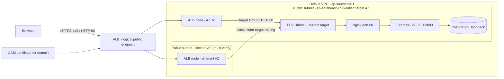

# Issue #34 — Thiết kế tích hợp Application Load Balancer

**Trạng thái: PROPOSED — thiết kế trên giấy, chưa tạo resource nào trên AWS.**

Tài liệu này trả lời câu hỏi "nếu đưa ALB vào kiến trúc PBL4-517 thì phải làm gì, theo thứ
tự nào, và chỗ nào dễ làm hỏng hệ thống đang chạy". Mọi dòng trong đây là **đề xuất**;
chưa có ALB, Target Group, listener hay Security Group mới nào được tạo.

- Issue: [#34 — AWS-05](https://github.com/LVTIT/PBL4-517/issues/34)
- Kiến trúc canonical: [wiki/ARCHITECTURE.md](../../wiki/ARCHITECTURE.md)
- Baseline AWS ngày 2026-11-03: [network-control-plane.md](network-control-plane.md),
  [EIP/HTTPS và renewal](ec2-eip-https.md)
- Hồ sơ triển khai ban đầu: [ec2-deployment-review.md](ec2-deployment-review.md),
  [docs/aws/linux-service-review.md](linux-service-review.md)
- Bối cảnh bảo mật: [wiki/SECURITY_PLAN.md](../../wiki/SECURITY_PLAN.md)

**Đồng bộ ngày 2026-11-04 với `main` tại `359acee`:** EIP hiện được ghi nhận là
`52.221.157.206`, region `ap-southeast-1`, subnet EC2 ở `ap-southeast-1c`.
Các quan sát ngày 2026-11-01 về IP cũ là lịch sử. Các giá trị dưới đây lấy từ
evidence đã có; lần đồng bộ tài liệu này không thực hiện kiểm tra hay thay đổi AWS.

---

## 1. Kiến trúc hiện tại (đã triển khai, không phải đề xuất)

```
Internet
   │  TCP 80/443
   ▼
Security Group EC2 (snapshot #33)
   │   22/TCP  ← IP quản trị /32
   │   80/TCP  ← 0.0.0.0/0
   │   443/TCP ← 0.0.0.0/0
   ▼
EC2 Ubuntu 24.04
   └── Nginx 1.24.0
         ├── listen 80   → 308 redirect sang https
         ├── listen 443  → Let's Encrypt cert cho địa chỉ IP
         ├── /           → frontend/dist (React SPA)
         └── /api/       → proxy_pass http://127.0.0.1:3000
                                │
                                ▼
                           Express (systemd: pbl4-backend.service)
                                │
                                ▼
                           PostgreSQL 16 @ 127.0.0.1:5432
```

Baseline kỹ thuật dùng xuyên suốt tài liệu; các thuộc tính runtime phải được kiểm
tra lại trong cửa sổ triển khai ALB, không suy ra từ source hay scan timeout:

| Thuộc tính | Giá trị hiện tại | Nguồn |
| --- | --- | --- |
| EIP / region / AZ EC2 | `52.221.157.206` / `ap-southeast-1` / `ap-southeast-1c` | `network-control-plane.md`, snapshot 2026-11-03 |
| Backend bind | `127.0.0.1:3000` (chỉ loopback), baseline cần giữ | `linux-service-review.md`; cửa sổ #33 chưa kiểm tra lại host binding |
| PostgreSQL bind | `127.0.0.1:5432`, baseline cần giữ | như trên |
| TLS | Let's Encrypt, cấp cho EIP `52.221.157.206` | `ec2-eip-https.md`, cửa sổ 2026-11-03 |
| `TRUST_PROXY` | chỉ nhận `'0'` hoặc `'loopback'` | `website/backend/src/lib/config.ts` |
| Cookie `Secure` | bật khi `NODE_ENV=production` | `website/backend/src/middleware/session.ts` |
| Nginx set `X-Forwarded-Proto` | `$scheme` | `docs/aws/ec2-deployment-review.md` |
| Nginx set `X-Forwarded-For` | `$remote_addr` | như trên |
| Health endpoint | `GET /api/health`, phụ thuộc database | `website/backend/src/routes/api-routes.ts` |

---

## 2. Kiến trúc đề xuất



Luồng request:

1. Browser → ALB:443 (TLS kết thúc tại ALB).
2. ALB → Target Group → EC2:80 (HTTP nội bộ VPC, chỉ ALB Security Group được gọi).
3. Nginx phục vụ frontend tĩnh và proxy `/api/` về `127.0.0.1:3000`.
4. Express đọc session từ PostgreSQL như hiện tại.

**Nguyên tắc bất biến:** ALB **không** được trỏ trực tiếp vào cổng 3000. Backend đang bind
loopback; mở nó ra VPC là hạ mức bảo mật hiện có. Nginx phải tiếp tục là biên giới.

---

## 3. Bảy ràng buộc phải xử lý trước khi tạo ALB

Đây là phần quyết định thành bại của issue. Bỏ qua bất kỳ mục nào cũng sẽ hỏng hệ thống
đang chạy.

### R1 — ALB bắt buộc ít nhất 2 subnet ở 2 Availability Zone khác nhau

Theo [tài liệu AWS](https://docs.aws.amazon.com/elasticloadbalancing/latest/application/application-load-balancers.html),
ALB yêu cầu chọn **tối thiểu hai subnet thuộc hai AZ khác nhau**, mỗi subnet có CIDR tối
thiểu `/27` và còn ít nhất 8 IP trống.

Hệ quả cho dự án: hiện chỉ có một EC2, nhưng vẫn **phải có subnet thứ hai**. Subnet thứ hai
không cần target; ALB vẫn tạo node ở đó. Việc này kéo theo:

- phải biết VPC hiện tại đã có subnet ở AZ thứ hai chưa;
- nếu chưa, phải tạo subnet + route table (không tốn phí bản thân subnet);
- nếu dùng cross-zone, traffic giữa hai AZ có thể phát sinh phí data transfer.

**Việc cần làm ở P0:** dùng #33 làm baseline, kiểm tra VPC ID và subnet/AZ thứ hai bằng AWS control plane, route tới IGW và số IP trống. **Bắt buộc enable `ap-southeast-1c` (AZ của EC2 hiện tại) trong ALB**, cộng thêm một AZ khác. Không mặc định các subnet `1a/1b` là đủ: target ở AZ không được enable có thể báo `unused / Target.NotInUse` và không nhận traffic ([AWS Target Health](https://docs.aws.amazon.com/elasticloadbalancing/latest/application/target-group-health-checks.html)). Không tạo subnet/ALB ở phase thiết kế.

### R2 — Target phải là `EC2:80` (Nginx), không phải `EC2:3000`

Backend bind `127.0.0.1:3000`. Một ALB nằm ngoài instance **không thể** kết nối tới địa chỉ
loopback. Vì vậy Target Group đăng ký theo **instance ID** với cổng `80`, giao thức `HTTP`.

Nếu sau này muốn ALB nói chuyện trực tiếp với Node, phải đổi bind sang private IP và thêm
một lớp kiểm soát khác — nằm ngoài phạm vi issue này và không được khuyến nghị.

### R3 — Chứng chỉ: ACM không cấp cho địa chỉ IP

[ACM public certificate](https://docs.aws.amazon.com/acm/latest/userguide/gs-acm-request-public.html)
yêu cầu *"DNS-compliant subject names"*, tức phải là tên miền. Baseline ngày
2026-11-03 dùng Let's Encrypt cho EIP `52.221.157.206`, với lineage
`pbl4-517-eip`; xem [SAN, thời hạn và kiểm chứng renewal](ec2-eip-https.md).
Chứng chỉ cấp cho EIP EC2 không xác thực tên miền ứng dụng hoặc DNS name của ALB.
Import một chứng chỉ không làm thay đổi các định danh trong SAN của nó; vì vậy
chỉ import lại cert EIP không giải quyết được HTTPS cho endpoint ALB đề xuất.

TLS probe ngày 2026-11-01 từng thấy cert cho IP cũ `13.251.128.130`, có thời hạn
khoảng 6,7 ngày. Đó là quan sát lịch sử, không phải chứng chỉ hiện tại và cũng
không chứng minh Certbot đã tự gia hạn: một cert mới có thể được cấp thủ công.
Bằng chứng ngày 2026-11-03 mới ghi nhận timer active/enabled và renewal dry-run
kèm deploy hook thành công. Chứng chỉ IP dùng profile `shortlived`; cần theo dõi
timer và thời hạn thực tế, đặc biệt sau khi EC2 bị dừng rồi khởi động lại.

Ba đường đi, phải chọn một trước khi triển khai:

| Phương án | Điều kiện | Đánh giá |
| --- | --- | --- |
| **A. Dùng tên miền + ACM** | Có tên miền trỏ về ALB (Route 53 hoặc DNS ngoài) | Đề xuất. Đúng mô hình ALB, cert tự renew, không cần cert trên EC2 |
| **B. Giữ Nginx TLS, dùng NLB** | Không cần tên miền, NLB passthrough TCP 443 | ALB **không** làm được TCP passthrough. NLB mất khả năng định tuyến L7. Ngoài phạm vi #34 nhưng là phương án trung thực nếu không có domain |
| **C. ALB + cert tự ký import** | Import cert vào ACM/IAM | Không đề xuất: trình duyệt cảnh báo, không chứng minh được gì khi demo |

**Chưa có tên miền trong dự án.** Đây là câu hỏi phải chốt với Team Leader trước khi làm
bất cứ bước nào, vì nó quyết định toàn bộ phần còn lại.

### R4 — `X-Forwarded-Proto` sẽ làm hỏng đăng nhập nếu giữ nguyên cấu hình Nginx

Đây là lỗi tinh vi nhất và gần như chắc chắn xảy ra.

Chuỗi hiện tại khi có ALB:

```
Browser --HTTPS--> ALB --HTTP :80--> Nginx --HTTP--> Express
```

Nginx đang đặt `proxy_set_header X-Forwarded-Proto $scheme;`. Sau ALB, `$scheme` tại Nginx
là `http`, nên Express nhận `X-Forwarded-Proto: http` → `req.secure === false`.

Trong khi đó `cookieOptions.secure = config.NODE_ENV === 'production'`
(`website/backend/src/middleware/session.ts`). Với `secure: true`, express-session **không
gửi cookie** khi request không được coi là HTTPS. Kết quả: đăng nhập trả 200 nhưng trình
duyệt không nhận được `pbl517.sid`, mọi request sau đó thành 401 — và rất khó đoán nguyên nhân.

Cách sửa (chọn một, ghi rõ trong cấu hình Nginx):

```nginx
# ALB đã set header này; Nginx chuyển tiếp thay vì ghi đè
proxy_set_header X-Forwarded-Proto $http_x_forwarded_proto;
```

hoặc, nếu chắc chắn mọi request vào Nginx đều đến từ ALB qua HTTPS:

```nginx
proxy_set_header X-Forwarded-Proto https;
```

Sau khi sửa **phải kiểm thử đăng nhập thật**, không chỉ kiểm tra header bằng curl.

### R5 — Mất IP thật của client

Nginx đang đặt `X-Forwarded-For $remote_addr`. Sau ALB, `$remote_addr` là **IP node của ALB**,
nên log, rate-limit và audit đều ghi sai người gửi. Rate limit đăng nhập hiện đếm theo IP
(`express-rate-limit`) — nếu mọi request cùng một IP ALB thì giới hạn sẽ áp dụng sai.

Cách sửa: bật `ngx_http_realip_module` với dải IP của ALB:

```nginx
set_real_ip_from <ALB subnet CIDR 1>;
set_real_ip_from <ALB subnet CIDR 2>;
real_ip_header X-Forwarded-For;
real_ip_recursive on;
```

Điều kiện an toàn: ALB phải giữ chế độ mặc định `routing.http.xff_header_processing.mode =
append` (ALB nối thêm IP client). Nếu đổi sang `preserve`, client có thể tự gửi
`X-Forwarded-For` giả và đánh lừa `real_ip`.

### R6 — Redirect 80 → 443 sẽ tạo vòng lặp hoặc đi thẳng vào EC2

Cấu hình redirect trong [cửa sổ HTTPS ngày 2026-11-03](ec2-eip-https.md):

```nginx
location / { return 308 https://52.221.157.206$request_uri; }
```

Khi ALB nói chuyện với Nginx qua cổng 80, Nginx sẽ trả 308 về `https://<IP>` — tức là
**bỏ qua ALB** và quay lại đúng con EC2. Hệ quả: phần TLS/lợi ích của ALB không được dùng,
và nếu Security Group EC2 đã đóng 443 công khai thì người dùng nhận lỗi kết nối.

Cách sửa: chuyển redirect lên **listener 80 của ALB** (ALB tự trả 301/302 sang 443), và
trong server block phía sau ALB thì **bỏ** dòng `return 308`, đổi `server_name` sang tên miền
mới.

### R7 — Health check phải phản ánh đúng sức khoẻ

Đề xuất Target Group health check:

| Tham số | Giá trị đề xuất | Lý do |
| --- | --- | --- |
| Path | `/api/health` | Có kiểm tra `SELECT 1` xuống PostgreSQL |
| Protocol / Port | HTTP / 80 (traffic port) | Đi qua Nginx như người dùng thật |
| Interval | 15 s | Cân bằng giữa phát hiện nhanh và tải |
| Timeout | 5 s | Nhỏ hơn interval |
| Healthy threshold | 2 | 30 s để nhận target |
| Unhealthy threshold | 3 | 45 s để loại target |
| Success codes | `200` | Chỉ 200 mới là khoẻ |

Đánh đổi cần biết: `/api/health` phụ thuộc database. Nếu PostgreSQL chết, endpoint trả
503 và target có thể chuyển unhealthy sau ngưỡng đã cấu hình. Tuy nhiên, theo
[tài liệu AWS](https://docs.aws.amazon.com/elasticloadbalancing/latest/application/target-group-health-checks.html),
khi toàn bộ target đã đăng ký đều unhealthy, ALB **fail open** và vẫn gửi request tới
các target đó. Với một EC2, không được hứa rằng ALB sẽ chặn toàn bộ site bằng 503:
frontend tĩnh có thể vẫn hoạt động, còn API phụ thuộc database có thể lỗi. Health check
không phải ranh giới phân quyền hay bảo đảm fail-closed; cần kiểm chứng từng endpoint.

**Kiểm chứng `Host` của health check:** ALB HTTP health checker dùng private IPv4 của target trong header `Host` (với port 80 là `Host: <private-IP>`), không nhất thiết là domain của website. Nginx phải có default server hoặc vhost xử lý `GET /api/health` và trả 200 ngay cả với Host kiểu đó. Thử trên đường nội bộ với Host `172.31.11.224` (giá trị snapshot #33, phải xác nhận lại lúc live), đồng thời kiểm tra `TargetHealth` thật khi triển khai; không suy 200 từ curl domain là health check PASS ([AWS troubleshooting](https://docs.aws.amazon.com/elasticloadbalancing/latest/application/load-balancer-troubleshooting.html)).

---

## 4. Cấu hình đề xuất

### 4.1 Listener

| Listener | Giao thức | Cổng | Hành động |
| --- | --- | --- | --- |
| `http` | HTTP | 80 | Redirect cố định sang `HTTPS 443` (mã 301) |
| `https` | HTTPS | 443 | Forward tới Target Group `pbl4-tg-web` (cert từ ACM, policy TLS 1.2+) |

Không đặt rule theo path ở ALB. Việc phân biệt `/api/` và `/` vẫn do Nginx làm, giữ nguyên
hành vi đã kiểm chứng.

### 4.2 Target Group

| Thuộc tính | Giá trị |
| --- | --- |
| Target type | `instance` |
| Protocol / Port | HTTP / 80 |
| VPC | VPC hiện tại của EC2 |
| Registered target | EC2 instance ID (một target duy nhất), AZ `ap-southeast-1c` phải được enable trên ALB |
| Health check | Bảng ở R7 |
| Deregistration delay | 30 s (mặc định 300 s là quá lâu cho demo) |
| Stickiness | **Tắt** — session nằm trong PostgreSQL, không phụ thuộc node |

### 4.3 Security Group

**SG mới `pbl4-alb-sg` (gắn vào ALB):**

| Chiều | Giao thức/Cổng | Nguồn/Đích | Ghi chú |
| --- | --- | --- | --- |
| Inbound | TCP 443 | `0.0.0.0/0` | Người dùng |
| Inbound | TCP 80 | `0.0.0.0/0` | Chỉ để redirect |
| Outbound | TCP 80 | SG EC2 `sg-0c0ebd38764b1df74` (tham chiếu SG) | Tới Nginx, gồm health check cùng cổng |

**SG hiện tại của EC2 (`sg-0c0ebd38764b1df74`, snapshot #33) — thay đổi đề xuất:**

| Chiều | Trước | Sau | Ghi chú |
| --- | --- | --- | --- |
| Inbound | 80 từ `0.0.0.0/0` | 80 từ `pbl4-alb-sg` | Bỏ truy cập trực tiếp |
| Inbound | 443 từ `0.0.0.0/0` | **Bỏ** (phương án A) | TLS đã ở ALB |
| Inbound | 22 từ IP quản trị `/32` | Giữ nguyên | Không nới rộng |
| Outbound | mặc định | Giữ nguyên | Không mở thêm |

Bắt buộc: luật của SG phải cho phép **cả cổng listener và cổng health check** theo cả hai
chiều, đúng như [tài liệu AWS về SG của load balancer](https://docs.aws.amazon.com/elasticloadbalancing/latest/application/application-load-balancers.html#load-balancer-security-groups)
yêu cầu.

### 4.4 Thuộc tính ALB nên bật ngay từ đầu

| Thuộc tính | Mặc định | Đề xuất | Lý do |
| --- | --- | --- | --- |
| `routing.http.drop_invalid_header_fields.enabled` | `false` | `true` | Loại header sai định dạng trước khi tới Nginx |
| `routing.http.xff_header_processing.mode` | `append` | giữ `append` | Cần cho R5, chống giả mạo XFF |
| `idle_timeout.timeout_seconds` | `60` | giữ `60` | Ứng dụng không có request dài |
| `access_logs.s3.enabled` | `false` | cân nhắc bật | Phục vụ #42 (đối chiếu log), nhưng cần bucket S3 và phát sinh chi phí |
| `deletion_protection.enabled` | `false` | `false` | Lab có kiểm soát, cần xoá được để dọn dẹp |

---

## 5. Thay đổi Nginx đề xuất (phương án A)

Chỉ phần khác biệt so với cấu hình hiện tại:

```nginx
server {
    listen 80 default_server;
    listen [::]:80 default_server;
    server_name pbl4.example.edu;          # tên miền thật, không phải IP

    # Không còn "return 308" — ALB listener 80 đã làm việc này.

    location ^~ /.well-known/acme-challenge/ {
        root /var/www/html;
        try_files $uri =404;
    }

    location = /api { return 308 /api/; }
    location /api/ {
        proxy_pass http://127.0.0.1:3000;
        proxy_http_version 1.1;
        proxy_set_header Host $host;
        proxy_set_header X-Real-IP $remote_addr;
        # $remote_addr đã là IP thật nhờ real_ip ở cấp http{}
        proxy_set_header X-Forwarded-For $remote_addr;
        # KHÔNG dùng $scheme ở đây (R4)
        proxy_set_header X-Forwarded-Proto $http_x_forwarded_proto;
    }
    location / { try_files $uri $uri/ /index.html; }
}
```

Phần `set_real_ip_from` đặt trong `http {}` của `/etc/nginx/nginx.conf`, không đặt trong
`server {}`.

Biến môi trường backend **không đổi**: `TRUST_PROXY=loopback` vẫn đúng, vì peer trực tiếp của
Express vẫn là Nginx trên loopback. `NODE_ENV=production` giữ nguyên, nên cookie vẫn `Secure`
— và đó chính là lý do R4 phải được xử lý.

---

## 6. So sánh kiến trúc hiện tại và kiến trúc qua ALB

| Tiêu chí | Truy cập trực tiếp EC2 (hiện tại) | Qua ALB (đề xuất) |
| --- | --- | --- |
| Điểm vào | IP công khai của EC2 | DNS name của ALB |
| TLS | Nginx + Let's Encrypt cho IP | ACM cho tên miền, tự renew |
| Định danh truy cập | EIP hiện tại ổn định khi còn được gán; đổi EIP cần cert phù hợp | Dùng tên miền; địa chỉ node ALB có thể thay đổi |
| Truy cập trực tiếp EC2 | Web public qua EIP `52.221.157.206` | Web chỉ nhận từ SG ALB sau hardening; EIP vẫn tồn tại cho SSH/rollback nên không thể khẳng định IP EC2 bị ẩn |
| Mở rộng | 1 instance, không cân bằng tải | Thêm target không cần đổi DNS |
| Health check | Không có health check phía ALB; systemd quản lý process | ALB ghi trạng thái target; nếu tất cả target unhealthy có thể fail-open, không bảo đảm cô lập lỗi |
| Chứng chỉ trên EC2 | Có, phải gia hạn và theo dõi | Không cần (phương án A) |
| WAF | Không gắn được | Gắn được vào ALB (ngoài phạm vi) |
| Chi phí | Chỉ EC2 | EC2 + phí ALB theo giờ và LCU |
| Độ phức tạp | Thấp | Cao hơn: 2 AZ, SG tham chiếu, XFF, redirect |
| Rủi ro khi triển khai | Không | R4/R5/R6 có thể làm hỏng đăng nhập nếu bỏ qua |

Kết luận thẳng: với **một** EC2, ALB không cải thiện hiệu năng. Giá trị thật của nó là
**che IP, quản lý TLS tập trung, health check và chỗ gắn WAF** — tức là phần bảo mật/vận hành,
đúng trọng tâm đề tài 517.

---

## 7. Chi phí

ALB tính phí theo **giờ chạy** cộng **LCU** (đơn vị dung lượng, lấy chiều cao nhất trong 4
chiều: kết nối mới, kết nối đồng thời, byte đã xử lý, số rule được đánh giá).

**Dự toán minh họa cho Singapore `ap-southeast-1` (không phải bill/quote AWS của tài khoản nhóm):** Dữ liệu tham chiếu từ [bảng giá ALB Singapore theo AWS offer file](https://cloud-credits.org/prices/alb/ap-southeast-1), đối chiếu cách tính với [AWS ELB Pricing](https://aws.amazon.com/elasticloadbalancing/pricing/) và [AWS VPC Pricing](https://aws.amazon.com/vpc/pricing/). **Phải xác thực lại bằng [AWS Pricing Calculator](https://calculator.aws/) tại thời điểm triển khai.**

| Khoản mục | Tham chiếu Singapore | Giả định ví dụ |
| --- | --- | --- |
| ALB running-hour | khoảng **0,0252 USD/giờ** | 1 ALB |
| LCU usage | khoảng **0,008 USD / LCU-giờ** | Trung bình 1 LCU |
| Public IPv4 | **0,005 USD / IPv4-giờ** theo AWS VPC pricing | Giả sử 2 public IPv4 cho 2 ALB AZ nodes |

Ví dụ **4 giờ demo** với 1 ALB, trung bình 1 LCU và 2 public IPv4:
`4 × (0,0252 + 1×0,008 + 2×0,005) = 0,1728 USD` (xấp xỉ **0,17 USD**).
Nếu chạy **730 giờ** cùng giả định: `730 × 0,0432 = 31,536 USD` (xấp xỉ **31,54 USD**).

Đây chỉ là kịch bản minh họa: LCU biến thiên theo traffic, số IPv4 ALB tiêu thụ có thể thay đổi khi scale; chưa bao gồm EC2/EIP hiện có, data transfer, S3 logs, thuế và ưu đãi/credit. Giá ALB region-specific là số tổng hợp công khai, **không phải kết quả truy vấn billing tài khoản**. Không có quyết định triển khai → giữ Proposed, không phát sinh chi phí ALB.

Ba lưu ý bắt buộc trước khi xin duyệt:

1. **Phải kiểm tra lại giá** cho `ap-southeast-1` (Singapore), region đã xác nhận
   trong #33, và tại thời điểm tạo. Các số Singapore ở trên vẫn chỉ là tham khảo, chưa phải báo giá hoặc chi phí thực tế của tài khoản. Dùng [AWS Pricing Calculator](https://calculator.aws/) và lưu ảnh kết quả.
2. Tài khoản tạo sau 15/07/2025 dùng cơ chế credit Free Tier mới; tài khoản cũ có thể còn
   750 giờ/tháng dùng chung giữa Classic và Application Load Balancer. Không giả định là miễn phí.
3. Nếu bật access log sang S3 thì phát sinh thêm phí lưu trữ — tách khỏi phạm vi #34.

**Không có con số nào ở trên là báo giá.** Đây là đầu vào để Team Leader quyết định.

---

## 8. Kế hoạch triển khai có kiểm soát

Chưa thực hiện bước nào. Mỗi bước có điều kiện dừng.

| Bước | Việc làm | Điều kiện dừng / rollback |
| --- | --- | --- |
| **P0 — Chuẩn bị** | Chụp VPC ID, subnet, AZ, CIDR, SG hiện tại; xác nhận có tên miền; ghi baseline `curl` và screenshot | Thiếu tên miền → dừng, chuyển sang phương án B (NLB) hoặc hoãn |
| **P1 — Xin duyệt** | Team Leader xác nhận chi phí và phạm vi bằng văn bản trong issue | Không có xác nhận → không tạo resource |
| **P2 — Tạo hạ tầng song song** | Tạo `pbl4-alb-sg`, `pbl4-tg-web`, ALB, listener với cert domain đã validate; **chưa đổi DNS** | Lỗi provisioning/cert → dừng; health check chưa thể xanh nếu Nginx vẫn redirect HTTP |
| **P3 — Chuẩn bị đường Nginx sau ALB** | Backup Nginx/SG; chuẩn bị vhost cho ALB, chỉ tin forwarded headers từ ALB và giới hạn EC2:80 theo SG ALB; áp dụng R4/R5/R6 sau `nginx -t`; giữ đường HTTPS trực tiếp có kiểm soát cho rollback | Kiểm tra riêng tác động lên HTTP-01: nếu port 80 chỉ cho ALB thì Let's Encrypt xác thực EIP bằng HTTP-01 từ Internet có thể không hoạt động; không coi auto-renew là bảo đảm khi SG/route đổi. Chốt phương án renewal/rollback được duyệt trước khi cắt direct web |
| **P4 — Kiểm thử trước đổi DNS** | Gọi URL tên miền với `curl --connect-to <domain>:443:<ALB-DNS>:443 https://<domain>/api/health` để giữ đúng TLS SNI/Host; kiểm tra target health, trang chủ và login | Chỉ đổi `Host` khi gọi URL DNS ALB không đủ để xác minh cert domain; target unhealthy hoặc login lỗi → dừng |
| **P5 — Chuyển DNS** | Trỏ tên miền về ALB; chờ TTL hết hạn | Giữ nguyên IP EC2 để quay lại nếu cần |
| **P6 — Đóng đường trực tiếp** | Bỏ 80/443 công khai khỏi SG EC2, chỉ cho `pbl4-alb-sg` | Đăng nhập/CSRF/checkout fail → mở lại 443 và rollback |
| **P7 — Kiểm chứng** | Đăng nhập, CSRF, đặt hàng, `/api/health`, scanner ngoài, header `X-Forwarded-*` | Ghi evidence, không tuyên bố PASS khi chưa chạy |
| **P8 — Dọn dẹp an toàn sau demo** | Trước khi xóa ALB: khôi phục Nginx/EIP site + đường HTTP-01, khôi phục SG direct 80/443 ở cấu hình baseline có kiểm soát, chuyển DNS về EIP nếu đã chuyển và chờ kiểm chứng hết TTL; kiểm tra trusted HTTPS, login/session, API health, Certbot timer và renewal path; **chỉ khi direct origin hoạt động lại ổn định mới xóa ALB → TG → SG** | Nếu bất kỳ bước phục hồi fail, **không xóa ALB**; quay về backup Nginx/SG/DNS đã chụp trước lab và xác định lại trạng thái dịch vụ. Ghi resource IDs, chi phí và xác nhận không còn ALB tính phí |

Rollback cần **khôi phục Nginx, SG và DNS về baseline EIP đã ghi**, rồi kiểm tra
HTTP-01, HTTPS, login và renewal theo [runbook EIP](ec2-eip-https.md). Chỉ đổi DNS
và mở lại 443 là chưa đủ nếu cấu hình Nginx/đường renewal đã thay đổi. P6 (đóng
đường HTTPS trực tiếp) chỉ được làm **sau** khi P5 đã ổn định. Nếu dùng cùng một Nginx config cho direct EIP và ALB thì có thể cần cửa sổ chuyển đổi/gián đoạn có kiểm soát; không hứa zero-downtime cho một EC2.

---

## 9. Những gì đã kiểm chứng và những gì còn phải xác minh

Đối chiếu ngày 2026-11-04 với evidence đã có; không phải một lượt live test mới:

| Mục | Cách kiểm | Kết quả |
| --- | --- | --- |
| EIP / region / subnet EC2 | [snapshot Console #33](network-control-plane.md) | `52.221.157.206`, `ap-southeast-1`, `172.31.0.0/20` tại `ap-southeast-1c` |
| Chứng chỉ cho EIP và trusted HTTPS | [cửa sổ HTTPS #14](ec2-eip-https.md), [live #33](../../evidence/AWS-04/live-20261103/README.md) ngày 2026-11-03 | Cert `pbl4-517-eip` khớp EIP; HTTPS/health 200 trong cửa sổ ghi nhận |
| Cấu hình renewal và deploy hook | `ec2-eip-https.md`, 2026-11-03 | Timer active/enabled, renewal dry-run kèm deploy hook PASS; không suy ra từ thời hạn cert đơn thuần |
| Backend bind loopback | đọc `linux-service-review.md` | Baseline `127.0.0.1:3000`; host binding chưa được kiểm tra lại trong live #33 |
| `TRUST_PROXY` chỉ nhận `0` hoặc `loopback` | đọc `website/backend/src/lib/config.ts` | Đúng — không có tuỳ chọn `true` chung chung |
| Cookie `Secure` theo `NODE_ENV` | đọc `website/backend/src/middleware/session.ts` | `secure: config.NODE_ENV === 'production'` |
| Nginx ghi đè `X-Forwarded-Proto` bằng `$scheme` | đọc cấu hình site trong `ec2-deployment-review.md` | Đúng — đây là gốc của R4 |
| Redirect 80 → 443 trỏ về EIP EC2 | đọc `ec2-eip-https.md` và live #33 | HTTP 308 sang `https://52.221.157.206/` |
| Quyền ingress và quan sát từ máy quản trị | `network-control-plane.md`, live #33 | 22 từ `/32` quản trị, 80/443 public; từ máy quản trị 22/80/443 reachable, 3000/5432/8080 timeout; chưa có non-admin SSH negative control |

Chưa kiểm chứng, không được coi là đã biết:

- [ ] VPC có public subnet thứ hai thuộc AZ khác `ap-southeast-1c` đủ điều kiện `/27`, ≥8 IP trống và route IGW chưa? ALB phải enable cả AZ của EC2 (`1c`) và AZ thứ hai.
- [ ] Subnet/AZ thứ hai, IP trống và routing có đủ cho ALB trong `ap-southeast-1` không?
- [ ] Có tên miền dùng được không, và ai quản lý DNS?
- [ ] Kế hoạch giám sát cert/timer và khôi phục renewal sau khi EC2 dừng/khởi động lại đã được nhóm duyệt chưa?
- [ ] Chứng chỉ ACM có validate được qua DNS/HTTP không?
- [ ] Tham chiếu SG `pbl4-alb-sg` trong luật inbound của EC2 có hoạt động đúng?
- [ ] Health check `GET /api/health` trả 200 khi `Host` là private IP của target, qua Nginx default vhost?
- [ ] Trong lúc EC2:80 chỉ cho phép ALB, cert EIP còn đường HTTP-01/renewal hợp lệ không; rollback có khôi phục trước khi ALB bị xóa không?
- [ ] `X-Forwarded-Proto` tới Express có thực sự là `https` (kiểm tra bằng log tạm, không log cookie)?
- [ ] `req.ip` trong rate-limit có phải IP thật của client không?
- [ ] Cookie `pbl517.sid` có còn `Secure; HttpOnly; SameSite=Lax` không?
- [ ] Scanner ngoài chỉ thấy ALB, không thấy cổng nào của EC2?
- [ ] Chi phí thực tế sau một ngày chạy là bao nhiêu?

---

## 10. Không nằm trong phạm vi

- Không tạo ALB, Target Group, listener, subnet hay Security Group nào trong issue này.
- Không mua tên miền, không thay đổi Route 53, không đổi DNS.
- Không cấu hình WAF, autoscaling, nhiều EC2, hay ALB → EC2 bằng HTTPS.
- Không thiết kế lại Network ACL; chỉ ghi chú rằng nếu dùng NACL tuỳ biến thì phải mở
  đúng luồng request/reply và ephemeral port theo client/OS thực tế; xem
  [phân tích SG/NACL của #33](network-control-plane.md#sg-vs-nacl-in-this-project).
- Không thay đổi cấu hình đang chạy trên EC2.

---

## 11. Câu hỏi cần nhóm chốt

1. **Tên miền**: có dùng tên miền cho đồ án không? Nếu không, ALB không phải lựa chọn đúng
   cho TLS — cần cân nhắc NLB hoặc giữ nguyên hiện trạng và ghi rõ lý do.
2. **Ngân sách**: ai chịu chi phí ALB và mức trần là bao nhiêu?
3. **Thời điểm**: có cần ALB trong W5 để demo, hay chỉ cần thiết kế để báo cáo?
4. **Subnet/AZ**: region đã xác nhận là `ap-southeast-1`; subnet ở AZ thứ hai nào
   sẽ được chọn, và đã kiểm tra routing/capacity cho ALB chưa?

Trả lời được bốn câu này thì mới nên chuyển từ PROPOSED sang triển khai.
