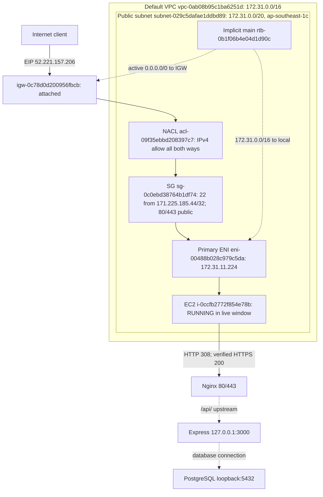

# AWS network architecture — Issue #33

**CURRENT / VERIFIED: control-plane snapshot plus authorized live window,
2026-11-03.** EC2 was Stopped during initial collection, then **Running** after
the user started it for live tests. [Evidence and findings](../../evidence/AWS-04/README.md).
SSH source refreshed after 16:40 UTC following the user's manual rule edit;
other network relationships retain the original snapshot timestamps.
**LIVE OBSERVED:** admin-source 22/80/443 reachable, HTTP 308, verified HTTPS and
health 200; 3000/5432/8080 timeout 2/2. Non-admin SSH negative control and host
binding/profile/revision verification remain pending; #33 remains OPEN.
**PROPOSED / outside this phase:** ALB expansion in #34 / PR #60. This audit
does not implement an ALB, listener, Target Group, certificate or DNS change.

## Current network path

The diagram shows resource boundaries and logical policy checks, not a chain of
SG/NACL proxy servers. The route table chooses forwarding; SG/NACL filter traffic.
The EIP maps Internet IPv4 to the ENI's private IPv4 at the IGW.

VPC DNS resolution and hostnames are Enabled. The subnet's auto-assign public
IPv4 is Yes, but the current public address is an associated EIP. Its effective
route table is the VPC main table through **implicit association**, proven by
the route table's Subnet associations tab. The active default route targets an
IGW Attached to this same VPC, establishing the subnet's public classification.
No IPv6 CIDR, route, ENI address/prefix or SG/NACL IPv6 rule was observed.
[Exact VPC/subnet/routes/IGW evidence](../../evidence/AWS-04/vpc-subnet-route.md).

The only attached SG has exactly three inbound permissions: TCP 22 from
`171.225.185.44/32`, TCP 80 and 443 from `0.0.0.0/0`. No rule covers 3000, 5432 or
8080. Outbound allows all IPv4 traffic. The user reported updating SSH to their
current IP; the reloaded Console rule and workstation public-IP check agree.
The old source is absent. The `/32` is a snapshot, not an automatic IP-tracking
rule; live SSH remains deferred. [Complete SG matrix, follow-up and historical
proposal](../../evidence/AWS-04/security-group.md).

## SG vs NACL in this project

| Property | Security Group | Network ACL |
| --- | --- | --- |
| Level | Primary ENI of this EC2 | Boundary of the EC2 subnet; this default ACL is shared by three subnets |
| Stateful | Yes | No |
| Allow rules | Yes | Yes |
| Explicit deny | No; unmatched ingress denied implicitly | Yes; terminal `*` DENY after numbered rules |
| Rule processing | Union of applicable attached SG permissions; no first-match order | Ascending rule number; first match wins |
| Return traffic | Allowed automatically for tracked permitted flows | Must match an independent rule in the opposite direction |
| Typical use here | Restrict SSH source; expose web only; block direct backend/DB/lab ingress | Current default rule 100 allows all IPv4 in/out; no selective service restriction |

For HTTPS, client temporary port → EC2:443 is allowed by SG and NACL. Replies
to the client's temporary port are tracked by SG and allowed by NACL outbound
100. The final NACL `*` DENY does not override an earlier matching 100 ALLOW.
Future restrictive NACL proposals need client/OS-specific ephemeral-port analysis;
no universal range is asserted. [Both NACL matrices and explanation](../../evidence/AWS-04/nacl.md).

The default ACL is permissive, so SG supplies the current service restriction.
Neither an EIP nor a public route makes backend/database public when SG denies
that ingress. Expected host loopback binding adds protection but is not a reason
to broaden SG. [Live observations](../../evidence/AWS-04/live-20261103/README.md)
now verify HTTPS/health from the admin workstation while Running. Host bindings
remain uninspected. `/api/version` returned 404 and `/release.json` returned SPA
HTML, so deployed revision/profile acceptance is not established. [Earlier EIP
HTTPS operating evidence](ec2-eip-https.md) remains separately dated evidence.

## Review and remaining work

- **PASS:** resource identity/EIP mapping, public route/IGW relationship, complete
  SG/NACL policy review, no public 3000/5432/8080 SG permission, IPv6 review.
- **INFO:** default VPC/NACL, unrestricted IPv4 egress and permissive NACL boundary.
- **PASS (follow-up configuration):** SSH `/32` now matches the user's current
  workstation public IP after their manual edit; previous source warning resolved.
  Agent performed no AWS mutation; live access/human review are still separate.
- **LIVE OBSERVED:** admin-source connectivity and web behavior above; negative
  port results are timeouts, not confirmed CLOSED. **PENDING:** non-admin SSH
  negative control and host binding/profile/revision verification.
  [Coverage matrix](../../evidence/AWS-04/live-test-plan.md).
- **Human review pending:** [20 teach-back answers](../../evidence/AWS-04/teach-back.md)
  are reference material, not proof of team understanding.

Network facts can feed #34's separate ALB work; this diagram has no deployed ALB.
Lab 8080 and alerts belong to #36/#41. No AWS mutation, SSH login, deploy,
EC2 start/stop/reboot or notification was performed by the agent. The user's
SSH-source edit and EC2 start are recorded separately. Bounded external probes
were explicitly authorized for the later live window. No issue closure or agent merge.

AWS sources: [SG behavior](https://docs.aws.amazon.com/vpc/latest/userguide/vpc-security-groups.html),
[NACL order/return traffic](https://docs.aws.amazon.com/vpc/latest/userguide/custom-network-acl.html),
[IGW/public subnet](https://docs.aws.amazon.com/vpc/latest/userguide/VPC_Internet_Gateway.html).
