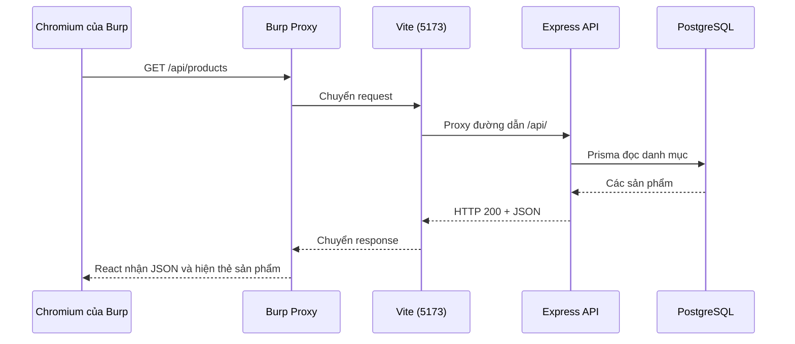
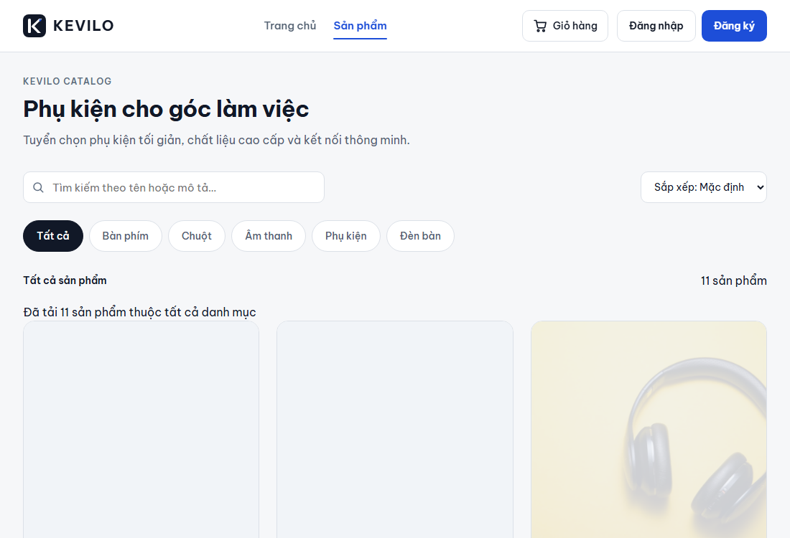

# Đọc luồng HTTP của KEVILO bằng Burp Suite Community

Sau bài này, bạn có thể chọn một thao tác trên KEVILO, tìm request tương ứng trong Burp, đọc kết quả và chỉ ra dòng xử lý quyết định kết quả đó. Dùng máy kiểm thử local với dữ liệu giả. Burp chạy độc lập với website.

## Chuẩn bị

1. Chuẩn bị môi trường theo [Local nhanh trên Windows](../../website/README.md#local-nhanh-tren-windows). Với buổi quan sát secure, từ gốc repo chạy `.\dev up`. Launcher quản lý API và frontend, ép cả bốn cờ lab về false trong process con. Dùng riêng phiên launcher này, tránh chạy thêm một API hoặc Vite bằng tay.
2. Cài **Community Edition** theo [hướng dẫn của PortSwigger](https://portswigger.net/burp/documentation/desktop/getting-started/download-and-install). Chọn dự án tạm trong bộ nhớ, dùng cấu hình mặc định. Trong **Settings → Tools → Proxy**, kiểm tra listener đang chạy trên loopback. Cổng mặc định là 8080. Nếu cổng bận, chọn cổng loopback còn trống.
3. Tại **Proxy → Intercept**, đặt **Intercept off**, rồi chọn **Open browser**. Trình duyệt đi kèm dùng sẵn proxy của Burp. Nhập `http://127.0.0.1:5173/products`. Trong **HTTP history**, chọn host `127.0.0.1:5173` và lọc đường dẫn `/api/`. Intercept off cho request đi ngay và vẫn ghi lịch sử. [Giao diện HTTP history của PortSwigger](https://portswigger.net/burp/documentation/desktop/tools/proxy/http-history)

Để nhận diện đúng tab trong lần mở đầu tiên, xem [ảnh nút Intercept off](https://portswigger.net/burp/documentation/desktop/images/getting-started/quick-start-pro-intercept-off.png) và [ảnh bảng HTTP history](https://portswigger.net/burp/documentation/desktop/images/getting-started/quick-start-pro-proxy-history.png). Đây là ảnh giao diện trong hướng dẫn của PortSwigger. Ảnh KEVILO bên dưới được chụp riêng trên máy local.

Ảnh chụp lúc kiểm tra secure trên máy local. Khi tải trang, Chromium nhận HTTP 200 cho danh mục gồm 11 sản phẩm. Ảnh minh họa đầu trình duyệt của sơ đồ.

## Bài thực hành đầu tiên

1. Chọn dòng **GET /api/products** trong History. Ở **Request**, tìm method, path và Host. Ở **Response**, tìm status, Content-Type và tên một sản phẩm trong JSON. Chỉ đúng thẻ có tên đó trên trang. Nếu chỉ thấy HTML, bạn đang xem request tải trang `/products`.
2. Từ menu chuột phải của request danh mục, chọn **Send to Repeater**. Mở **Repeater**, kiểm tra host và port local rồi bấm **Send** một lần. So sánh status và sản phẩm với lần đầu. Repeater tự gửi request HTTP, nên trang đang mở trong browser vẫn giữ nội dung cũ.
3. Trong giao diện KEVILO, tìm một tên sản phẩm có sẵn rồi tìm một tên hư cấu. Ở History, chọn riêng phần body JSON của từng response và dùng **Send to Comparer**. Chọn hai bản trong **Comparer**, bấm **Words**. Ghi số kết quả và tên trường khác nhau. Cả hai lần có thể cùng trả 200 dù danh sách khác nhau. [Hướng dẫn Comparer](https://portswigger.net/burp/documentation/desktop/tools/comparer)
4. Thực hành [bốn bài đọc HTTP và mã nguồn](labs.md). Ghi commit, chức năng, kết quả mong đợi, kết quả quan sát, công cụ và trạng thái từng bài. Khi chụp ảnh chỉ lấy vùng path/status hoặc nội dung công khai của danh mục. Đăng nhập, cookie, token và manifest fixture chỉ dùng trong phiên riêng. Đóng dự án tạm sau buổi học, chạy `.\dev down` nếu bạn đã dùng launcher.

Nếu History trống, kiểm tra lại listener, mở trang bằng **Open browser**, tắt bộ lọc và tải lại. Nếu request đứng chờ, xem tab Intercept. Nếu trang mở được nhưng API lỗi, kiểm tra health theo README website và đối chiếu status API trước khi kết luận về lab.

Community hỗ trợ quan sát, phát lại và so sánh HTTP thủ công. Quét web tự động bằng Burp Scanner là tính năng Professional. Việc vá lỗi diễn ra ở source backend/frontend. Với A05, kết nối TCP, baseline và cảnh báo Discord/Telegram, tiếp tục dùng [External Scanner](../../scanner/README.md). Listener của Burp cũng dùng một cổng TCP, nên đóng Burp trước bài đo baseline nếu hai bài dùng cùng cổng.
