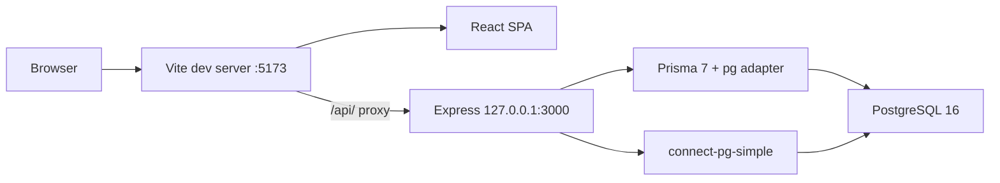
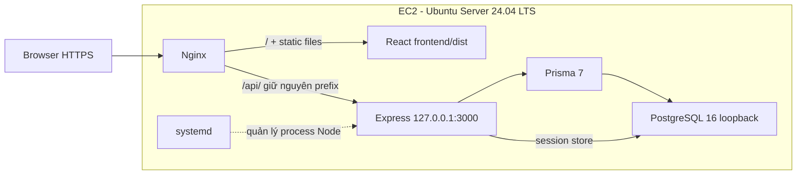
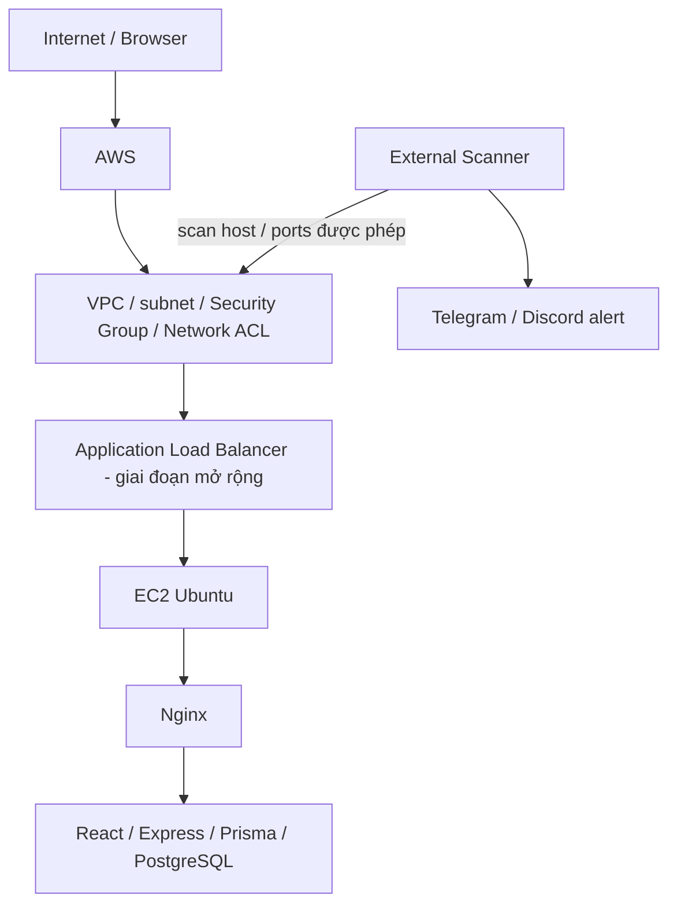

# Architecture

## Website local — Issue #8

**Status: Implemented trong source; trạng thái kiểm thử/DoD xem [CURRENT_STATUS.md](CURRENT_STATUS.md).**

Frontend gọi `/api/...` bằng relative URL. Express tách routes, controllers, services, middleware và database client; `server.ts` chỉ khởi động/dừng server. PostgreSQL chứa user, product và session. Danh sách sản phẩm đi qua Prisma; giá dùng Decimal. Session cookie HttpOnly trỏ tới session phía server; login/logout kiểm tra CSRF token. Hợp đồng API và cách chạy ở [website/README.md](../website/README.md).

## Website production trên EC2

**Status: Implemented; service lifecycle and reboot/autostart verified in Issue #15 (2026-10-02).** Nginx phục vụ frontend và HTTPS/API với chứng chỉ IP, PostgreSQL và Express chỉ loopback. Backend chạy bằng systemd, active/enabled; stop/start/restart, journal và tự khởi động sau một lần reboot đã kiểm chứng. [Service evidence và giới hạn](../evidence/LINUX-02/README.md), [cấu hình/bàn giao](../docs/aws/linux-service-review.md). CI/review của PR được theo dõi riêng với kết quả vận hành.

Nginx phục vụ static frontend và reverse proxy API; SPA fallback chỉ áp dụng cho frontend. Backend chạy JavaScript đã compile bằng Node, không dùng `tsx` trong production. Database và backend bind loopback; frontend không cần thay URL API. Cookie Secure yêu cầu HTTPS; `trust proxy` phải khớp proxy thật sự kiểm soát. Chi tiết cấu hình triển khai thuộc các issue EC2/Linux tiếp theo.

## AWS network — control plane verified 2026-11-03 (Refs #33)

EC2 `i-0ccfb2772f854e78b` is **Stopped** in the current AWS Console snapshot.
EIP `52.221.157.206` maps to primary ENI/private IPv4 `172.31.11.224` in the
default VPC `172.31.0.0/16`, subnet `172.31.0.0/20` (`ap-southeast-1c`). The
subnet implicitly uses the main route table with an active IGW default route;
the IGW is attached to the same VPC, proving public IPv4 routing. The attached
SG allows SSH from `117.3.54.230/32`, web 80/443 public and no public
3000/5432/8080. The default NACL allows all IPv4 in both directions; SG supplies
the service restriction. No IPv6 configuration/rules were observed. SSH source
ownership/current use still needs confirmation. Runtime and host binding checks
are deferred; previous service evidence above remains historical.

[Actual resource diagram, SG/NACL comparison and boundaries](../docs/aws/network-control-plane.md),
[current evidence and future live test plan](../evidence/AWS-04/README.md).
No AWS resources/configuration changed. ALB remains outside this implemented
path and belongs to the planned expansion below.

## PBL4 tổng thể

**Status: Planned.** Sơ đồ dưới đây biểu diễn phạm vi mạng và trách nhiệm, không coi VPC/Security Group/NACL là các server nối tiếp.

Giai đoạn đầu có thể phục vụ trực tiếp qua Nginx trên EC2; ALB thuộc giai đoạn mở rộng đã nêu trong đề tài, chưa triển khai. Cấu hình SG/NACL, subnet, TLS và chuỗi trust proxy phải được xác minh khi triển khai. Scanner chạy từ bên ngoài và không cần truy cập database website.

Tài liệu này lưu kiến trúc lâu dài; chưa thay thế checklist/evidence của [Issue #11 — Architecture v0.1](https://github.com/LVTIT/PBL4-517/issues/11). Các bước EC2, deploy, Linux service, kiểm thử và tài liệu triển khai nằm ở Issues [#12](https://github.com/LVTIT/PBL4-517/issues/12)–[#17](https://github.com/LVTIT/PBL4-517/issues/17); kiểm tra từng issue trước khi triển khai.

## One-EC2 demo profile — 2026-10-26

The user selected the existing EC2/Nginx HTTPS origin for both secure and
intentionally vulnerable synthetic-data phases. FE/BE artifacts stay identical
between phases; only acknowledged lab flags change and the backend restarts.
A separate synthetic `kevilo_lab` database on that EC2 avoids overwriting existing
data. Windows Python/browser runs outside AWS. No second EC2 or public backend/DB
port is required. [Decision](DECISIONS.md), [runbook](../scripts/attacker/README.md).
Implementation and actual AWS acceptance remain distinct in CURRENT_STATUS.
